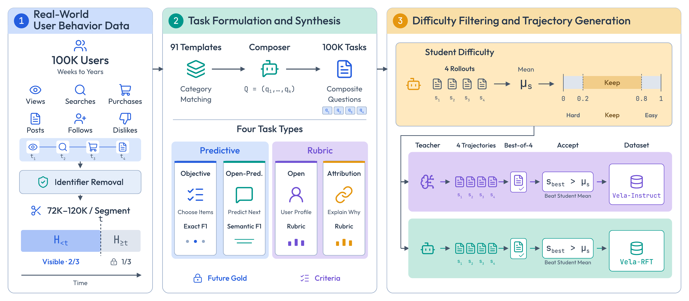
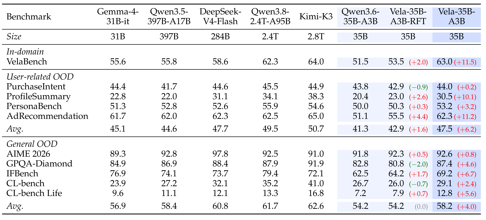
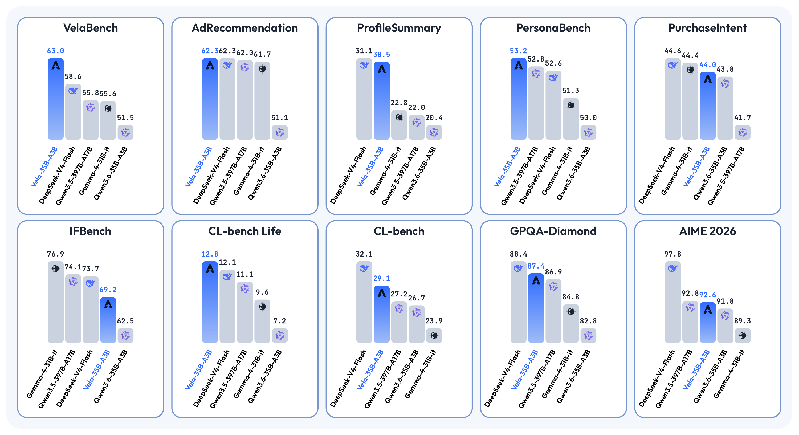
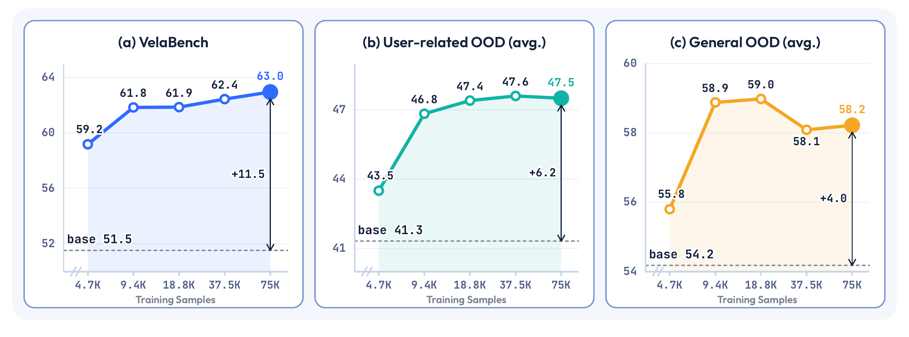
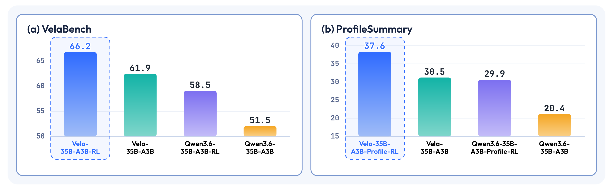
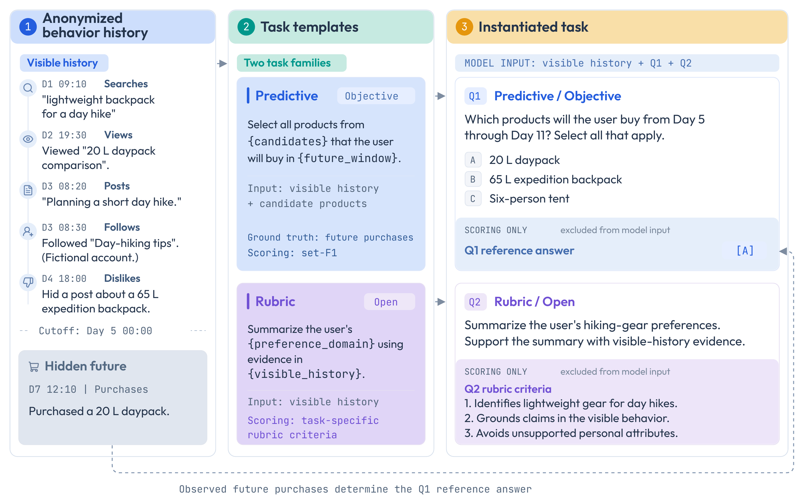

# Vela: User Behavior as Supervision Sparks LLM Intelligence

Vela explores **user behavior as supervision**: learning from anonymized records of what users actually do to improve how large language models understand individual preferences, intent, and behavior over time.

The Vela framework turns anonymized real-world behavior histories into training tasks and trajectories. Its tasks ask models to predict future behavior, summarize interests, and explain observed outcomes using evidence from a user's history. Experiments show gains in both user-related and general capabilities, alongside a stronger foundation for subsequent reinforcement learning.

This repository provides **74 selected task templates** from Vela, organized into four question types. The templates describe how to construct questions, define the available evidence, and evaluate answers.

*Vela converts behavior histories into tasks, selects useful training examples, and builds training trajectories.*

## Highlights

- **Behavior-grounded supervision.** Predictive answers come from observed behavior; open-ended answers are evaluated against task-specific criteria grounded in the available evidence.
- **Diverse user-understanding tasks.** The paper studies 91 templates across six behavior categories: views, searches, purchases, posts, follows, and dislikes.
- **Improvements beyond user-related tasks.** Fine-tuning Qwen3.6-35B-A3B on approximately 75,000 Vela-Instruct examples improves performance across all ten evaluated benchmarks.
- **Benefits for further training.** Under the same RL data and settings, models trained with Vela before RL outperform those trained with RL directly from the base model.

## Results

The main model, **Vela-35B-A3B**, is fine-tuned on Vela-Instruct, constructed from anonymized behavior histories of 100,000 users.

VelaBench evaluates held-out users. The independent user-related benchmarks cover purchase intent, profile summarization, persona understanding, and ad recommendation. General benchmarks cover mathematics, science, instruction following, and context learning.

*Table 1 from the paper. Parentheses show score changes relative to Qwen3.6-35B-A3B; Avg. denotes the mean within each benchmark group.*

In separate RL experiments, Vela-based models reach **66.2 on VelaBench** and **37.6 on ProfileSummary**, compared with **58.5** and **29.9** when RL starts from the base model. These experiments use the Vela checkpoint trained on 18.8K examples; both comparisons are between models **after RL**.

*Vela-35B-A3B (blue) compared with the base model and selected reference models across ten benchmarks.*

### Data scaling and reinforcement learning

Increasing Vela-Instruct from 4.7K to 75K examples raises VelaBench scores from 59.2 to 63.0 and the average on independent user-related benchmarks from 43.5 to 47.5.

*Dashed lines indicate base-model performance.*

*Scores before and after RL. The Vela starting checkpoint in this experiment uses 18.8K training examples.*

## Explore the templates

| Family | Question type | Templates | Purpose |
| --- | --- | ---: | --- |
| Predictive | [Objective](templates/objective/) | 23 | Predict behavior using the response format specified by the task, such as selecting items from a candidate list. |
| Predictive | [Open-prediction](templates/open-prediction/) | 18 | Predict behavior targets without a candidate list. |
| Rubric | [Open](templates/open/) | 9 | Analyze visible history, such as summarizing interests or comparing behavior over time. |
| Rubric | [Attribution](templates/attribution/) | 24 | Explain an outcome disclosed in the question using evidence from earlier behavior. |

The 74 templates included here form a selected subset, rather than the complete 91-template collection used in the paper.

### Start with an example

Consider an illustrative history: a user searches for a lightweight backpack, views a comparison of small daypacks, and expresses interest in short hikes. A later record shows a daypack purchase.

The same history can support different questions:

- **Objective:** Which products from a candidate list will the user purchase? See the [purchase prediction template](templates/objective/purchase_intent_ecom_goods.md).
- **Open-prediction:** Which products is the user likely to purchase, without being given candidates? See the [open purchase prediction template](templates/open-prediction/purchase_intent_ecom_goods_open_prediction.md).
- **Open:** Which interests are supported by the visible history? See the [evidence-grounded interest template](templates/open/interest_profile_behavior_open.md).
- **Attribution:** Given the disclosed purchase, which earlier behaviors help explain it? See the [purchase attribution template](templates/attribution/purchase_intent_ecom_goods_attribution.md).

For predictive questions, the later purchase is available only to the evaluator. Attribution questions explicitly disclose the outcome, so they must not be combined with a predictive question about that same outcome. Explanations should identify supporting evidence without claiming that the history establishes causation.

*An illustrative history forms predictive and open questions. Hidden future behavior supplies the predictive answer; a rubric evaluates the open response.*

## Using a template

No installation is required to browse the library. To adapt a template to your own task:

1. **Choose a question type and behavior target.** Each file begins with a task definition and conditions describing when it can be used.
2. **Prepare the evidence.** Use appropriately authorized, anonymized records. Define the visible history and, where required, the future window. Keep answer-bearing future information out of predictive inputs.
3. **Construct the question and evaluation material.** Follow the template's rules for candidates, target labels, response format, and scoring. Open-ended tasks may require a task-specific rubric.
4. **Evaluate the answer.** Use the stated metric or rubric, including the conditions for insufficient evidence or invalid answers. Keep evaluation users separate from training users when measuring generalization.

Each template includes the task definition, prerequisites, question formulation, evidence boundaries, answer format, scoring criteria, optional variations, and a seed prompt. The sections **出题条件** and **不出题/不合格** describe when a task should not be constructed or an answer should not be accepted.

In the templates, a **composer** instantiates a task and a **scorer** evaluates an answer. `[E…]` denotes visible evidence, while `[F…]` denotes an observed outcome disclosed for attribution. Parameters such as `{{OPEN_PREDICTION_TASK_LIMIT}}` must be supplied when constructing a task; they are not example user data.

## Composer and Scorer prompts

The system prompts from the paper appendix are available in English and Chinese:

| Role | English | 中文 | Purpose |
| --- | --- | --- | --- |
| Composer | [composer.en.txt](prompts/composer.en.txt) | [composer.zh.txt](prompts/composer.zh.txt) | Construct Open and Attribution questions and their task-specific rubrics from a selected template and permitted behavior evidence. |
| Scorer | [scorer.en.txt](prompts/scorer.en.txt) | [scorer.zh.txt](prompts/scorer.zh.txt) | Extract objective answers, normalize open predictions through semantic matching, and evaluate rubric-based responses. |

The Composer expects a selected template, visible history, and a response schema. Attribution tasks also supply the observed outcome to disclose in the question. The Scorer expects the task, its scoring specification, the evaluated model's response, and an output schema.

These prompts describe the paper's evaluation protocol: semantic normalization followed by set-F1 for Open-prediction, and equal-weight rubric criteria for Open and Attribution. When adapting templates with configurable scoring parameters, keep the task specification and scorer consistent with the protocol you choose. An execution program must supply the inputs, validate the returned JSON, and compute the rule-based metrics.

## Contact

For questions about Vela, contact Yang Xiao at [yang-alan.xiao@connect.polyu.hk](mailto:yang-alan.xiao@connect.polyu.hk).
